<!-- ===================== BANNER ===================== --> 
  
 <!-- ===================== TYPING ===================== --> 
  
 
    

~/whoami
bash
$ whoami
lucas — dev de tucumán 🇦🇷, estudiante en la UTN FRT, freelancer en las sombras

$ cat now.txt
> haciendo cosas para la web que funcionan (casi siempre)
> rompiendo prod en local para no romperlo en serio
> aprendiendo inglés, arquitectura y cloud

$ cat afk.txt
> 🎬 películas a las 3am
> 🎮 LoL, survivals y FPS tácticos (no me pregunten el elo)

no soy un senior, soy un tipo que no deja de aprender. not a senior, just a guy who never stops learning.

~/stack

  

~/projects
<table> <tr> <td width="50%" valign="top"> <h3>🐾 adopción de mascotas</h3> 
plataforma para adoptar responsablemente. mi TFI, o sea, el jefe final de la carrera.  <i>responsible pet adoption platform — final boss of my degree.</i>
  </td> <td width="50%" valign="top"> <h3>💼 trabajos freelance</h3> 
sitios y herramientas para clientes reales, con deadlines reales y café real.  <i>real clients, real deadlines, real coffee.</i>
  </td> </tr> </table>
~/stats --no-filter

   
 
  
 
  

 <code>// si llegaste hasta acá, dejá una ⭐ o mandame un mensaje. no muerdo.</code> 
 
  

